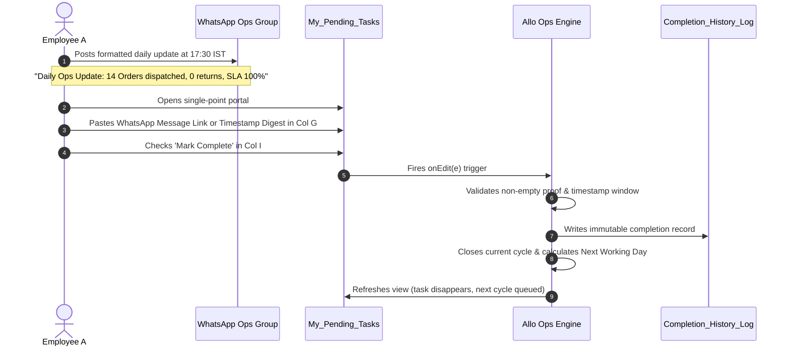
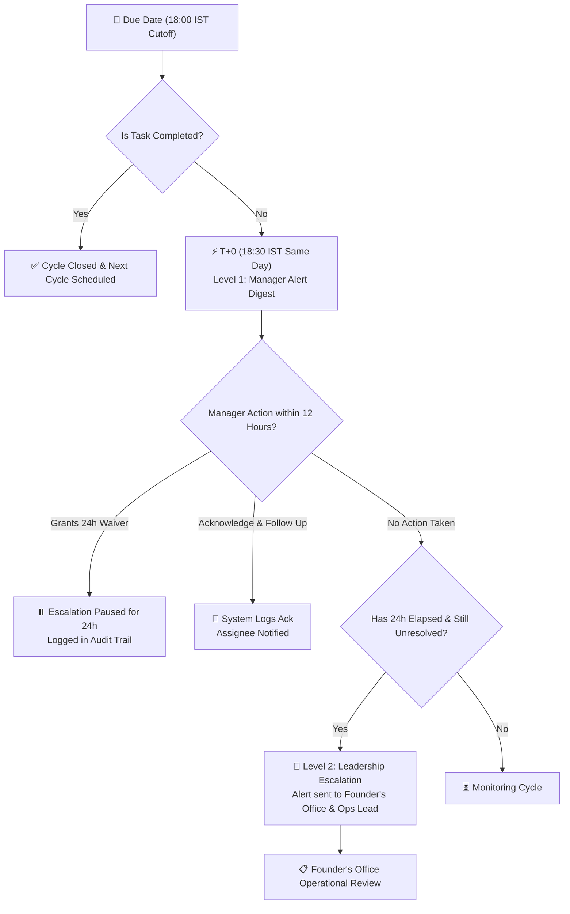

# ALLO INNOWARE — AI OPERATIONS / FOUNDER'S OFFICE
## Recurring Task Tracking, Pending Reports & Escalation Automation System
### Comprehensive Architecture, Daily Task Strategy & SLA Specification

---

## 1. Executive Summary & Problem Diagnosis

At **Allo Innoware**, operational excellence depends on the timely and consistent execution of recurring workflows across team members. In fast-paced operational environments, recurring task management typically suffers from four acute operational failure modes:
1. **Spreadsheet Bloat & Multi-Tab Friction**: Employees are forced to navigate multiple tracking sheets, log tickets in one place, and report status in another, causing high friction and missing updates.
2. **The "WhatsApp Black Box"**: Daily operational updates (e.g., WhatsApp group posts, standup summaries) do not generate native ticket IDs, leading to ambiguous completion proof, manual follow-ups, or unverified check-the-box behavior.
3. **Reactive vs. Proactive Manager Oversight**: Managers discover delayed tasks days late during ad-hoc reviews rather than receiving automated, same-day exception alerts.
4. **Email Fatigue & Alert Blindness**: Poorly designed notification systems trigger individual spam emails for every event, causing managers to ignore notifications until critical bottlenecks impact leadership.

### The Solution: Allo Ops Sentinel Engine
We have engineered a **Google Sheets + Google Apps Script** enterprise prototype that transforms Google Sheets from a static ledger into an active, event-driven operations engine. It features:
- **Zero-Friction Single-Point Completion**: Employees view only their active pending tasks and log ticket IDs/proof right in place.
- **Automated Recurrence State Machine**: Upon completion, the active cycle is archived to an immutable audit log, and the next cycle is instantly computed and scheduled without human intervention.
- **Verifiable Daily Task Protocol**: A pragmatic, timestamped digest hash mechanism tailored for WhatsApp and Slack updates.
- **Tiered SLA & Escalation Ladder**: Same-day Manager Alert (T+0) followed by Leadership Escalation (T+24h) with manager acknowledgement and waiver controls.
- **Strict Idempotency**: Concurrency locks and state flags that guarantee **zero duplicate cycles and zero duplicate emails**.

---

## 2. System Architecture & Data Model

The system is partitioned into six specialized sheets, separating configuration, live operational state, user execution, and immutable audit logs:

```mermaid
flowchart TD
    subgraph Master Config
        TM[⚙️ Task_Master<br/>Task Cadence, Proof Type, Assignees]
        SLA[⚙️ SLA_Settings<br/>Cutoff Hours, Grace Period, SLAs]
    end

    subgraph Active Engine
        AC[🔄 Active_Cycles<br/>Live Operational State Machine]
    end

    subgraph User Interfaces
        MPT[📋 My_Pending_Tasks<br/>Single-Point Employee Portal]
        MD[📊 Manager_Dashboard<br/>Control Tower & Review Desk]
    end

    subgraph Audit & Escalation
        LOG[📜 Completion_History_Log<br/>Immutable Historical Audit Log]
        GMAIL[📧 Automated Alerts & Escalations<br/>Level 1: Manager | Level 2: Leadership]
    end

    TM -->|Seeds / Initializes| AC
    AC <-->|Real-Time 2-Way Sync / onEdit| MPT
    MPT -->|Completion Trigger & Proof| AC
    AC -->|Archives Completed Cycle| LOG
    AC -->|Recalculates Next Due Date| AC
    AC -->|Monitors Overdue & SLAs| GMAIL
    AC <-->|Aggregates Live KPIs & Acks| MD
```

### Detailed Tab Specifications

| Sheet Name | Role | Primary Users | Key Fields |
| :--- | :--- | :--- | :--- |
| **`⚙️ Task_Master`** | System of Record / Configuration | Operations Lead / Founder | `Task_ID`, `Task_Name`, `Assigned_To`, `Frequency`, `Frequency_Days`, `Proof_Type`, `Cutoff_Time`, `Manager_Email`, `Leadership_Email` |
| **`🔄 Active_Cycles`** | Operational State Machine | Automation Backend | `Cycle_ID`, `Task_ID`, `Due_Date`, `Status`, `Manager_Alert_Sent`, `Manager_Ack_Status`, `Leadership_Escalation_Sent` |
| **`📋 My_Pending_Tasks`** | Single-Point Execution Portal | Team Members (Employees A–D) | `Cycle_ID`, `Task_Name`, `Due_Date`, `Status`, `Enter Proof / Ticket ID`, `Employee Remarks`, `Mark Complete [✓]` |
| **`📜 Completion_History_Log`** | Immutable Audit Ledger | Auditing / Performance Review | `Log_ID`, `Cycle_ID`, `Task_ID`, `Completed_At`, `Completed_By`, `Proof_Submitted`, `Turnaround_Status`, `Days_Late` |
| **`📊 Manager_Dashboard`** | Control Tower & Review Desk | Operations Manager | KPI Metric Cards, Overdue Items Watchlist, Action Selector (`Acknowledge`, `Grant Waiver`, `Mark Resolved`) |
| **`⚙️ SLA_Settings`** | Configurable Governance Parameters | Founder's Office | `DEFAULT_CUTOFF_HOUR` (18:00), `MANAGER_GRACE_HOURS` (12h), `LEADERSHIP_SLA_HOURS` (24h), `SEND_ACTUAL_EMAILS` |

---

## 3. Daily Task Completion Methodology (Test 3 Analysis)

### The Operational Dilemma
Unlike portal tasks that naturally generate a trackable Ticket ID (e.g., Jira `#OPS-4021`, Zendesk `#10492`), daily operational tasks—such as sharing daily dispatches or standup updates in a WhatsApp group—lack native system-of-record identifiers. 

Common approaches fail:
- *Simple Checkbox ("I did it")*: Prone to unverified rubber-stamping and zero accountability.
- *Screenshot Upload to Drive*: High friction (download image, upload to Drive, copy link), leading to employee resistance and broken workflows.

### Proposed Solution: The 3-Tier Verifiable Daily Update Protocol



### The 3 Supported Input Methods for Daily Tasks:
1. **Method 1: Direct WhatsApp Message Link (Recommended for WhatsApp Web/Desktop)**
   - In WhatsApp Desktop / Web, right-click any message in a group and select **"Copy Message Link"** (e.g., `https://chat.whatsapp.com/...` or message URI).
   - The employee pastes this into Column G (`Enter Proof / Ticket ID`).
   - *Advantage*: 1-click verification for the manager.
2. **Method 2: Formatted Timestamp Digest String (Zero Extra Tools)**
   - If message links are disabled in the WhatsApp group, the employee enters a standard formatted digest string:
     `WA-1730-14Dispatches-0Returns` or `Shared in #Ops-APAC @ 17:45 IST`.
   - The system checks that the string matches the required structure and records the employee's user email as the submitter.
3. **Method 3: Inbound Webhook (Zero Manual Entry Future Upgrade)**
   - By attaching a lightweight WhatsApp Business API or Google Chat / Slack incoming webhook, posting `#dailyops` in the team channel can automatically call the Apps Script Web App URL (`doPost`), completing the task in the sheet with **zero manual spreadsheet entry**!

---

## 4. Manager Alerts & Leadership Escalation SLA (Tests 4, 5, 6, 7)

### Escalation Timeline & Decision Matrix



### SLA Parameter Specifications

| Level | Timing / SLA | Trigger Condition | Recipient | System Action | Content |
| :--- | :--- | :--- | :--- | :--- | :--- |
| **Cutoff** | **18:00 IST** (Due Date) | Standard operational workday boundary | Assignee | System flags status as `PENDING_CUTOFF` | Visual warning in sheet. |
| **Level 1 Alert** | **18:30 IST** (Due Date) | Task uncompleted after 18:00 cutoff on Due Date | **Operations Manager** | Sets `Manager_Alert_Sent = TRUE`, updates timestamp, marks `OVERDUE` | Consolidated HTML email digest of all team exceptions with 1-click Sheet link. |
| **Manager Review Grace** | **12 Hours** (09:00 IST Next Morning) | Manager alerted at 18:30 | Operations Manager | Manager reviews in `Manager_Dashboard` | Options: Acknowledge, Grant 24h Waiver, or Resolve Manually. |
| **Level 2 Escalation** | **24 Hours** post Level 1 Alert | Task uncompleted AND no approved waiver granted | **Founder's Office & COO** (CC Manager) | Sets `Leadership_Escalation_Sent = TRUE`, marks `ESCALATED` | Critical SLA breach notice detailing employee, task, days late, manager notes, and breach duration. |

### Why This Design Eliminates Notification Fatigue:
1. **Consolidated Daily Digests vs. Spam**: If 3 employees miss tasks on the same day, the manager receives **one clean consolidated table email** at 18:30 IST, not 3 separate emails.
2. **Manager Autonomy with Accountability (Waivers)**: Legitimate operational blockers occur (e.g., external portal down). The manager can grant a 24-hour waiver from the dashboard, pausing leadership escalation while recording an auditable reason.
3. **Graceful Escalation**: Leadership is not bothered with transient 30-minute delays; they only see systemic delays exceeding 24 hours where management intervention failed.

---

## 5. Concurrency Control & Idempotency Guarantee (Test 8)

In Google Sheets automation, automated triggers (e.g., hourly time-driven triggers or multiple users editing concurrently) can trigger duplicate emails or corrupt recurring cycle calculations.

Our system implements enterprise safeguards:
1. **Script Locks (`LockService.getScriptLock()`)**:
   - `completeTaskCycle()`, `checkAndSendManagerAlerts()`, and `checkAndSendLeadershipEscalations()` acquire atomic locks before reading or writing rows. Concurrent triggers queue safely rather than executing race conditions.
2. **Boolean State Transition Flags**:
   - Every active cycle row stores `Manager_Alert_Sent (Col 17)` and `Leadership_Escalation_Sent (Col 22)`.
   - Once an alert fires, the flag is flipped to `TRUE`. Subsequent trigger runs skip rows where the flag is already `TRUE`.
3. **Deterministic Cycle Numbering**:
   - Cycle IDs are uniquely formatted (`CYC-[TaskID]-C[CycleNumber]`), preventing duplicate active instances for the same task.
4. **Calendar-Anchored vs. Completion-Anchored Recurrence**:
   - Periodic tasks (7, 15, 30 days) anchor their next due date to the scheduled due date rather than the completion date, preventing operational cadence drift.
